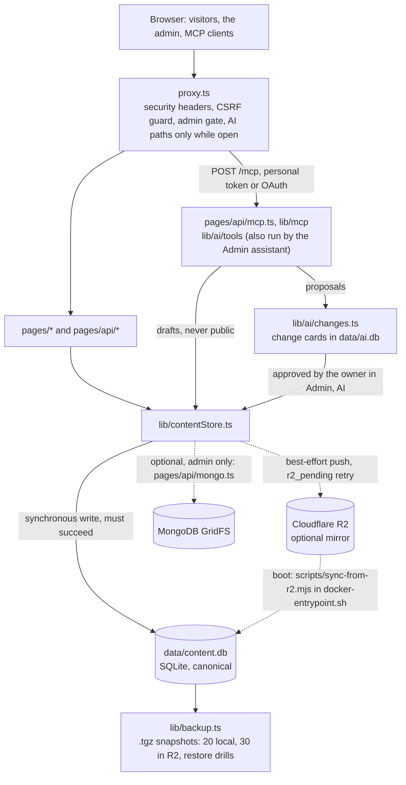

<div align="center">

# Portfolio Studio

**English** · [中文](./README.zh.md)

**A self-hosted personal site, bilingual CV and blog with an admin studio; content lives in one SQLite file, optionally mirrored to Cloudflare R2.**

For one person's site, CV and writing, run as one container with one admin account. Not multi-tenant, not a hosted service.

[](./LICENSE)
[](./package.json)
[](./package.json)
[](./lib/contentStore.ts)
[](./docker-compose.yml)


</div>

- `data/home.json` and `data/cvdata.json` seed a missing row and never overwrite one; a write that misses R2 is recorded in `r2_pending` and reconciled at boot (`lib/contentStore.ts`, `scripts/sync-from-r2.mjs`).
- One CV at `/cv` and `/cv/zh`, downloadable as `/cv.pdf`, `/cv.txt` and `/cv.json`; hidden fields are pruned on the server (`lib/cvVisibility.ts`).
- Whole-site `.tgz` snapshots every `BACKUP_INTERVAL_HOURS` (24), 20 kept locally and 30 in R2, and a restore drill every `RESTORE_DRILL_INTERVAL_HOURS` (168) (`lib/backup.ts`, `lib/restoreDrill.ts`).
- AI is off by default: an MCP server at `/mcp` and an assistant on your own provider key share 24 tools in three scopes, and nothing an AI writes goes public until the owner approves it (`lib/ai/`).
- No hosted CI: the gates are local commands (`yarn run check`, `yarn build`, `node scripts/perf-budget.mjs`).

## Quick start

Needs Node 22 (`.nvmrc`: 22.23.4; `engines`: `>=22.18`) and Yarn classic (`npm i -g yarn`; `yarn.lock` is a v1 lockfile).

```bash
git clone https://github.com/hiko-server/portfolio-studio.git
cd portfolio-studio
yarn
cp .env.example .env
openssl rand -base64 32   # the JWT_SECRET value
# edit .env: JWT_SECRET = that output; ADMIN_EMAIL and ADMIN_PASS = your own (the example values are not a password)
yarn content:migrate      # seeds data/content.db from data/home.json and data/cvdata.json
yarn dev                  # http://localhost:3000
```

You get the demo home page and CV from the two JSON seeds. Posts, case studies, `/now` and `/uses` start empty: `content/` holds only `.gitkeep` files in git. Sign in at `/admin/login` (no nav link; the ⌘K palette and the URL reach it) with `ADMIN_EMAIL` / `ADMIN_PASS`; the admin record is created from them on first boot. `yarn build && yarn start` serves the production build on `http://localhost:3002`.

### Docker

```bash
cp .env.example .env                                                 # after the clone above: JWT_SECRET, ADMIN_EMAIL, ADMIN_PASS
cp docker-compose.override.example.yml docker-compose.override.yml   # once per host; gitignored
docker compose up -d --build                                         # http://127.0.0.1:3002
```

The copy is not optional: `docker-compose.yml` publishes `127.0.0.1:8000` on an external network named `easilycv` and keeps data in the named volumes `landing-data` and `landing-uploads`; the override replaces the port with `127.0.0.1:3002` and the network with the default one, and bind-mounts `./data` and `./public/uploads`, which the container writes as uid 1001 (on a Linux host make them writable for that uid). `.env` is read through `env_file`; `NEXT_PUBLIC_SITE_HOST`, `NEXT_PUBLIC_PRODUCT_NAME`, `NEXT_PUBLIC_DEFAULT_THEME` and `NEXT_PUBLIC_BUILD_SHA` are build arguments, so changing them needs `--build`. The image's `yarn install --frozen-lockfile` fails the build when `yarn.lock` is out of sync.

Next: edit under Admin → Home editor, CV Studio, Posts and Case studies; every variable is described in [`.env.example`](./.env.example); production, backups and the deploy script are in [docs/deployment.md](docs/deployment.md) and [docs/operations.md](docs/operations.md).

## What it does

**Public site**
- Pages `/`, `/about`, `/contact`, `/now`, `/uses`, `/colophon`; Chinese pages `/zh`, `/zh/about`, `/zh/blog`, `/zh/work`, `/zh/contact` exist only while the owner wrote the Chinese copy (`lib/zhSite.ts`).
- Feeds and machine-readable twins: `/feed.xml`, `/work/feed.xml`, `/feed.json`, `/sitemap.xml` with hreflang, `/llms.txt`, `/blog/<slug>.md`, social cards at `/api/og` (`lib/feeds.ts`).
- ⌘K palette with Search and Ask modes over `/api/search-index`; Ask answers only with quotes from the site, and the mode's label is a string in `lib/ask/copy.ts`, renamed per site (`lib/ask/`).

**Writing**
- Posts at `/blog` and case studies at `/work` in MDX (Markdown with components), compiled on the server to a tree with Shiki highlighting, no eval (`lib/mdx.ts`).
- TipTap visual editor with MDX source parity, drafts, pending changes on live items, slug rename with redirects, version history with rollback (`components/Admin/RichEditor.tsx`).
- Scheduled publish and unpublish with catch-up after a restart, review links for 1 hour to 30 days at `/review/<token>`, linked translations via `translationKey` (`lib/schedule/scheduler.ts`).

**CV studio**
- The PDF is rendered on the server with embedded fonts, the text is plain, the JSON is JSON Resume 1.0.0, and each has a `/cv/zh.*` twin (`lib/cvExport/`).
- Hide any section, entry, field or bullet separately for the website and the PDF; the public `/api/cvdata` is always pruned, editors use `/api/admin/cvdata` (`lib/cvVisibility.ts`).
- Up to 24 named variants with private links `/cv/r/<token>`, a `/publications` page with BibTeX, APA and JSON-LD, ORCID import (below) and recruiter-readiness checks (`lib/cvVariants.ts`).

**Admin studio**
- Home editor for hero, highlights, section order and visibility, availability, brand logos, photos, contact copy and GitHub organizations (`components/Admin/HomeEditor.tsx`).
- Media library with usage index, alt text, replace and a 30-day trash; WebP and AVIF variants are made at upload, there is no on-request optimizer (`lib/media/`).
- Inbox with SMTP replies and templates; analytics with goals, CSV export and a weekly digest to `NOTIFY_EMAIL`; error monitor; activity log; system health page (`lib/analytics/`).
- Sign-in with password or passkey, recovery codes, step-up for dangerous actions and sign-in history under Admin → Security; every admin page opens from the ⌘K palette (`lib/adminAuth/`).

**Storage and backups**
- Five SQLite stores — content, analytics, auth, audit, ai — with versioned, additive migrations run at boot; `yarn db:status` reports them (`scripts/db/migrate.mjs`).
- *Backup now* and *Pull latest* in Admin → Storage: a restore pulls `backups/latest.tgz` from R2 or a local tarball, writes a safety snapshot first and asks for a recent sign-in (`pages/api/admin/storage/pull.ts`).
- Content export as a `.zip` of Markdown and JSON, `yarn content:pull` / `content:push` / `content:list` for the R2 mirror, and an optional MongoDB GridFS target at `/admin/db-config` (`pages/api/admin/export.ts`).

Page-by-page detail: [docs/authoring.md](docs/authoring.md), [docs/admin.md](docs/admin.md), [docs/architecture.md → Public routes](docs/architecture.md#public-routes).

### Connect your ORCID iD

The CV studio's *Connect your ORCID iD* button needs `ORCID_CLIENT_ID`, `ORCID_CLIENT_SECRET` and an ORCID client whose redirect URI is `https://example.com/api/admin/orcid/callback` (the origin of `SITE_URL` plus that path); `ORCID_ENV=sandbox` targets the sandbox. Steps: [docs/authoring.md → Connect your ORCID iD](docs/authoring.md#connect-your-orcid-id).

## AI: an MCP server and your own model

Off by default. Two switches in Admin → AI → Connections, *AI access* and *Allow connected apps* (`lib/ai/settings.ts`, stored in `data/auth.db`); `AI_DISABLED=1` in the environment turns everything off whatever the settings say; the public addresses also need `SITE_URL`, and stored model keys need `AI_KEYS_SECRET`. While off, every AI address answers exactly like an unknown page.

Two ways in, one set of 24 tools:

- **Connected apps** reach the MCP (Model Context Protocol) server at `/mcp` (Streamable HTTP, JSON responses, tools only; `pages/api/mcp.ts`, `lib/mcp/`) with a personal token (`pst_` prefix, 90 days by default) or OAuth 2.1 at `/oauth/authorize`, `/oauth/token`, `/oauth/register` and `/oauth/revoke` (`lib/ai/access.ts`, `lib/ai/oauth.ts`).
- **The assistant** in Admin → AI runs the same tools on a key you add for one of 15 presets — Claude, OpenAI, xAI, OpenRouter, DeepSeek, Gemini, Qwen, Kimi, GLM, MiniMax, Mistral, Groq, Ollama, LM Studio or a custom OpenAI-compatible endpoint (`lib/ai/presets.ts`); the server runs the tool loop, and keys are sealed with AES-256-GCM under `AI_KEYS_SECRET` (`lib/ai/secretBox.ts`).

| Scope | Tools | What it adds |
|---|---|---|
| `content:read` | 8 | read what visitors can read: site overview, pages, CV, home, content health, the authoring guide, search, the media list |
| `content:draft` | 14 | also create and edit drafts, set media alt text, list versions and its own changes; nothing a visitor or a review link can see |
| `content:propose` | 24 | also propose publishing, page, home, CV and tag edits, deletes, restores and media imports; each becomes a change card |

"Manage the site" means its content through the CMS. Never code, deploys, files, the inbox, analytics, error reports, logs, backups, keys, tokens, sessions or settings: no tool exists for them, approved or not.

The inbox, the visitor analytics and the error reports stay the owner's alone: **AI assistants never see any of it**. Assistants read published content and, when the owner allows it, drafts; what a tool reads goes to the provider the owner chose for that task, under that provider's terms. No tool reads contact messages, analytics or error reports: `tests/ai-boundary.test.ts` fails if anything the tools load reaches the inbox, analytics, error, log, backup, mail or CV-share code, and `tests/ai-tools-leak.test.ts` plants a sentinel in every hidden place and checks that no tool returns it.

Nothing an AI writes goes public until the owner approves it: drafts stay drafts, proposals wait as change cards in Admin → AI → Changes (approve, reject or undo; `lib/ai/changes.ts`), waiting changes expire after 7 days and the pre-AI state is kept for 90 days, and every AI write is recorded in the activity log before it happens (`lib/ai/audit.ts`).

Tokens, pairing, OAuth, budgets and the conformance runs: [docs/ai.md](docs/ai.md); the posture: [SECURITY.md → AI access](./SECURITY.md#ai-access); a local trial with synthetic content: [docs/ai-trial.md](docs/ai-trial.md).

## Architecture

Request path, store and the AI path (solid arrows must succeed, dotted ones are best-effort or optional):



- `proxy.ts` — runs on the Node runtime before every route: https redirect for the public host, trailing-slash 308, security headers on every response, the CSRF guard on unsafe methods for `/api/admin/*`, `/api/auth/*`, `/api/cvdata`, `/api/home`, `/api/versions` and `/api/mongo`, the admin gate for `/admin/*` and `/api/admin/*`, and the AI public paths only while open (`lib/aiPublicRoutes.js`).
- `lib/contentStore.ts`, `lib/db.ts`, `lib/r2.ts` — the synchronous SQLite write must succeed; the R2 push is best-effort with retries, a failed key lands in `r2_pending` and `scripts/sync-from-r2.mjs` reconciles it at boot (pending keys first, then the newer side by timestamp).
- `scripts/db/migrate.mjs`, `scripts/migrate-db.mjs` — five stores (`content.db`, `analytics.db`, `auth.db`, `audit.db`, `ai.db`; the last three 0600), versioned additive migrations run at boot from `instrumentation.ts` after a `VACUUM INTO` copy under `data/backups/pre-migration/`.
- ISR (Incremental Static Regeneration): `/` and `/about` every 3600 s, `/cv` and `/cv/zh` 60 s, `/contact` 300 s, posts and case studies 60 s, `/colophon` static; on-demand revalidation after every save and HTML kept at the edge for at most 5 minutes (`lib/isr.ts`, `lib/revalidate.ts`, `lib/edgeHtmlTtl.ts`).
- `docker-entrypoint.sh` under dumb-init: `scripts/sync-from-r2.mjs` (exit 0 or 3 continues, anything else refuses to serve an empty site), `scripts/static-archive.mjs`, `scripts/warm-isr.mjs` in the background, then `exec node server.js`.
- `lib/backup.ts`, `lib/backupSchedule.ts`, `lib/restoreDrill.ts` — a snapshot holds `MANIFEST.json`, an online copy of `content.db`, `data/snapshots/`, `uploads/` and the contact inbox, never `data/admin.json` or `data/mongo_config.json`; the schedule is change-aware; drills restore the newest backup into a scratch folder.
- `pages/api/mcp.ts`, `lib/mcp/`, `lib/ai/tools/`, `lib/ai/changes.ts`, `lib/ai/apply.ts` — the MCP handler and the assistant share one tool registry; proposals become change rows in `data/ai.db` and are applied only on approval.

`data/content.db` is canonical; `data/home.json`, `data/cvdata.json` and `content/*.mdx` are a one-way seed that fills only a missing row; Cloudflare R2 is a mirror that boot reconciles.

One admin account per deployment (`lib/admin.ts`); there is no multi-tenancy.

Store internals, how to add a migration, every public route with its handler, the project layout and the test suites: [docs/architecture.md](docs/architecture.md).

## Stack and layout

| Layer | Package | `package.json` |
|---|---|---|
| Framework | next (Pages Router, `--webpack`) | 16.4.2 |
| UI | react, react-dom | ^18.2.0 |
| Components | @chakra-ui/react; framer-motion | ^2.8.2; ^10.15.0 |
| Language | typescript | ^5.3.3 |
| Content store | better-sqlite3 | ^12.10.0 |
| MDX pipeline (compiled on the server to a syntax tree) | unified; remark-mdx; shiki | 11.0.5; 3.1.1; ^4.1.0 |
| Editor | @tiptap/* | 3.31.3 |
| Images and PDF | sharp; pdfkit | 0.35.5; 0.20.2 |
| AI and MCP | @modelcontextprotocol/server; @anthropic-ai/sdk | 2.4.0; 1.1.0 |
| Tests and runtime | node:test on Node `>=22.18` (`.nvmrc` 22.23.4); @playwright/test; @axe-core/playwright | 1.63.0; 4.13.0 |

Layout: `assets/` (font sources and PDF font subsets) `components/` `content/` `data/` `docs/` `e2e/` `layout/` `lib/` (`lib/ai/`, `lib/mcp/`) `pages/` (`pages/api/`, `pages/admin/`) `public/` `scripts/` (`scripts/db/`, `scripts/ci/`) `security/` `styles/` `tests/` `theme/` `types/`, plus `proxy.ts`, `instrumentation.ts`, `docker-entrypoint.sh` and the `Dockerfile`; the annotated tree is in [docs/architecture.md → Project layout](docs/architecture.md#project-layout).

## Privacy and security

Defaults, each with its mechanism:

- One admin account per deployment; scrypt (N=16384, r=8, p=1) password hashes in `data/admin.json`; 7-day JWT cookie sessions with revocation; passkeys, recovery codes and step-up within `ADMIN_RECENT_AUTH_MINUTES` (10) (`lib/admin.ts`, `lib/auth.ts`, `lib/adminAuth/`).
- Login throttle per e-mail and IP with a global slowdown, never a global lockout (`lib/security/loginThrottle.ts`).
- CSRF (cross-site request forgery) guard — 403 cross-site, 415 form bodies — on unsafe admin and auth methods; the client IP is read from `TRUST_CLIENT_IP_HEADER` only when the peer is in `TRUSTED_PROXY_IPS` (`proxy.ts`, `lib/security/csrf.ts`, `lib/rateLimit.ts`).
- Hash-based CSP (Content Security Policy) without `'unsafe-eval'` in production, Trusted Types report-only, HSTS; SSRF-safe (server-side request forgery) outbound fetch (`lib/csp.js`, `lib/security/safeFetch.ts`).
- Container: `cap_drop: ALL`, `no-new-privileges:true`, `pids_limit: 256`, `mem_limit: 1g`, port published on `127.0.0.1` only, uid 1001, node:22-alpine pinned by digest (`docker-compose.yml`, `Dockerfile`).
- Analytics are first-party and cookieless: no IP or user agent stored, the visitor is a daily-salted hash, DNT and Sec-GPC honoured, raw page views 35 days, raw Web Vitals 30 days, roll-ups 400 days, no third-party script (`lib/analytics/ingest.ts`).
- Contact messages expire after `CONTACT_RETENTION_DAYS` (365) nightly at 19:00 UTC; the form uses a signed nonce, a sum and a honeypot, no external captcha (`lib/inboxRetention.ts`, `lib/security/contactChallenge.ts`).
- `.env` is gitignored and dockerignored and is never part of a snapshot; neither is `data/admin.json` (`.gitignore`, `.dockerignore`, `lib/backup.ts`).
- AI is off by default, and no AI tool reads the inbox, analytics or error reports (previous section).

### Reporting a vulnerability

Do not open a public issue. E-mail the `Contact:` address in the deployment's `/.well-known/security.txt` (RFC 9116), for example `https://example.com/.well-known/security.txt`: each deployment generates the file per request from the public CV e-mail (`pages/api/security-txt.ts` via a rewrite in `next.config.js`, 180-day rolling `Expires:`) and answers 404 while the CV hides the address. Scope, out-of-scope items and the targets — acknowledgement 72 hours, assessment 7 days — are in [SECURITY.md](./SECURITY.md#reporting-a-vulnerability).

### Known limitations

- The rate limiter is an in-process `Map` and resets on restart; behind a proxy or with more than one instance, add a persistent limiter at the proxy or at Cloudflare (`lib/security/rateLimitCore.ts`).
- One admin account per deployment; not multi-tenant (`lib/admin.ts`).
- No hosted CI; the gates are local commands (Quality gates below).

## Deploying

`yarn build && yarn start` serves the production build on port 3002 (`next start -p ${PORT:=3002}`); the Docker image serves the same build as Next's standalone output behind `docker-entrypoint.sh` (R2 reconcile, static archive, server, ISR warm-up).

`scripts/deploy.sh [--force]` is the one deploy path: it runs on your machine and drives one host over `ssh $DEPLOY_HOST` (overrides `DEPLOY_HOST`, `DEPLOY_DIR`, `DEPLOY_SITE_URL`), takes backups, ships the commits as a git bundle, builds, switches, waits for `/api/health` to answer `ok`, purges the edge, smoke-tests through `DEPLOY_SITE_URL` and rolls back automatically on any failure after the switch; a stale edge copy is reported, not rolled back. Steps and post-deploy checks: [docs/deployment.md](docs/deployment.md).

### Cloudflare

Optional. With `CF_API_TOKEN`, `CF_ZONE_ID` and `SITE_URL` in `.env`, `node --env-file=.env scripts/cloudflare-config.mjs --dry-run --host example.com` previews an idempotent zone configuration for that host (rules tagged `lp_`); run it without `--dry-run` with a short-lived token. At runtime the first two, set in `.env`, purge refreshed URLs after every save and the whole zone after a deploy (`scripts/edge-purge.mjs`), and HTML stays at the edge for at most 5 minutes (`lib/edgeHtmlTtl.ts`). Details and the token scopes: [docs/deployment.md → Cloudflare](docs/deployment.md#cloudflare).

## Quality gates

There is no hosted CI (`.github/` holds templates and `dependabot.yml`, no `workflows/`): these commands are the gate before a push to `main`.

| Command | What must pass |
|---|---|
| `yarn run check` | `tsc --noEmit`, ESLint with zero warnings, the `node:test` unit suite (off-machine network refused by `tests/no-network.mjs`; needs no `.env`) |
| `yarn build`, then `node scripts/perf-budget.mjs` | the build and the performance budget of `scripts/perf-budget.mjs` (first-load JS, CSS, font preloads, no server-only marker in a client chunk) |
| `yarn e2e` | Playwright + axe (`e2e/`), default base `http://127.0.0.1:3000`; add `--grep-invert @admin` unless the store is disposable |
| `yarn audit:deps` | no high or critical finding in production dependencies unless allow-listed with an expiry in `security/audit-allowlist.json` |
| `bash scripts/ai-e2e.sh`, `MCP_CONFORMANCE_TOKEN=<token> bash scripts/mcp-conformance.sh http://127.0.0.1:<port>` | the AI flows on the standalone server with the scripted model, and `@modelcontextprotocol/conformance` plus the Inspector CLI against `tests/mcp-conformance-baseline.yml`; required for changes under `lib/ai`, `lib/mcp`, `components/Admin/ai` |
| `scripts/check-container.sh`, `scripts/check-fixture-gates.sh` | the hardened, loopback-only container and the fixture store's performance, layout and visual baselines (both need Docker) |

Every row in full, with when each is required: [docs/operations.md → Quality gates](docs/operations.md#quality-gates).

## Where things live

| File | Read it when |
|---|---|
| [docs/architecture.md](docs/architecture.md) | you change the store, add a migration, or need the request path, the ISR timings, every public route with its handler, the project layout or the test suites |
| [docs/authoring.md](docs/authoring.md) | you write posts or case studies, edit the CV, hide fields, make variants, add publications or connect ORCID |
| [docs/admin.md](docs/admin.md) | you want every admin page explained: dashboard tabs, home sections, GitHub data and organizations, inbox, analytics views, content health |
| [docs/operations.md](docs/operations.md) | you run it: every environment variable, the five stores, backups and restores, restore drills, health, errors, the activity log, CLI scripts, the quality gates in full |
| [docs/deployment.md](docs/deployment.md) | you ship it: the Docker image and compose files, the override contract, the boot order, `scripts/deploy.sh`, Cloudflare |
| [docs/ai.md](docs/ai.md) | you connect an app to `/mcp`, add a model key, or need tokens, OAuth, budgets, change cards and the conformance runs |
| [docs/ai-trial.md](docs/ai-trial.md) | you want to try the AI feature on your machine with synthetic content |
| [docs/screenshots/README.md](docs/screenshots/README.md) | you replace the screenshots (file names, sizes, the no-personal-data rule) |
| [`.env.example`](./.env.example) | you set up `.env`: every variable with its default and range |
| [SECURITY.md](./SECURITY.md) | you report a vulnerability or want the security posture and the operator's responsibilities |
| [CONTRIBUTING.md](./CONTRIBUTING.md) | you send a change: local checks, commit conventions, the AI boundary |
| [CHANGELOG.md](./CHANGELOG.md) | you want what changed, by release (`/colophon` shows the same releases) |

## Contributing

- Read [CONTRIBUTING.md](./CONTRIBUTING.md). There is no hosted CI: run `yarn run check`, `yarn build` and `node scripts/perf-budget.mjs` before every push to `main` (the full set is under Quality gates).
- Changes under `lib/ai/tools/**` follow [The AI boundary](./CONTRIBUTING.md#the-ai-boundary-read-this-before-touching-libaitools) and keep `tests/ai-boundary.test.ts` passing.
- Commits follow conventional commits (`feat:`, `fix:`, `docs:`; `!` marks an operator-visible change).

## License

[MIT](./LICENSE) — Copyright (c) 2023-2026 hiko-server and contributors.
