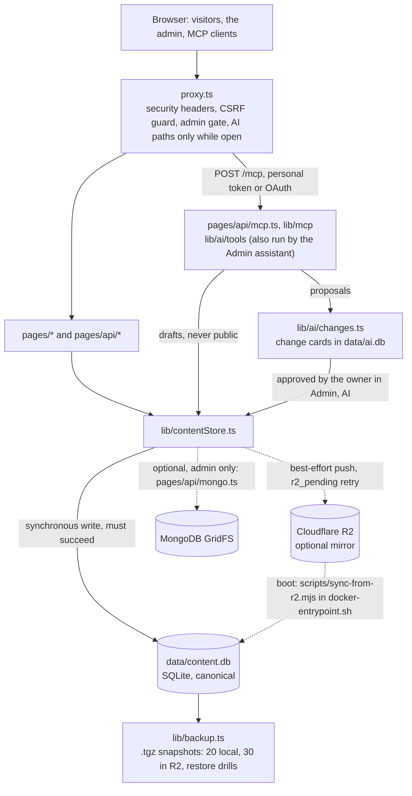

<div align="center">

# Portfolio Studio · 个人作品集工作台

[English](./README.md) · **中文**

**可自托管的个人站点、双语简历与博客，自带后台工作台；全部内容存于一个 SQLite 文件，可选镜像到 Cloudflare R2。**

为一个人的站点、简历与写作而设计：一个容器、一个管理员账号。不是多租户系统，也不是托管服务。

[](./LICENSE)
[](./package.json)
[](./package.json)
[](./lib/contentStore.ts)
[](./docker-compose.yml)


</div>

- `data/home.json` 与 `data/cvdata.json` 只在对应行缺失时补种，从不覆盖已有的行；未能写入 R2 的改动记入 `r2_pending`，启动时对账补齐（`lib/contentStore.ts`、`scripts/sync-from-r2.mjs`）。
- 一份简历，位于 `/cv` 与 `/cv/zh`，可下载为 `/cv.pdf`、`/cv.txt` 与 `/cv.json`；隐藏的字段在服务端即被剔除（`lib/cvVisibility.ts`）。
- 每隔 `BACKUP_INTERVAL_HOURS`（24）小时生成一份全站 `.tgz` 快照，本地保留 20 份、R2 保留 30 份；每隔 `RESTORE_DRILL_INTERVAL_HOURS`（168）小时做一次恢复演练（`lib/backup.ts`、`lib/restoreDrill.ts`）。
- AI 默认关闭：`/mcp` 上的 MCP 服务器与使用你自己服务商密钥的助手共用 24 个工具、三个权限范围，AI 写的任何内容未经站长批准都不会公开（`lib/ai/`）。
- 没有托管 CI：关卡是本地命令（`yarn run check`、`yarn build`、`node scripts/perf-budget.mjs`）。

## 快速开始

需要 Node 22（`.nvmrc`：22.23.4；`engines`：`>=22.18`）与 Yarn classic（`npm i -g yarn`；`yarn.lock` 是 v1 格式的锁文件）。

```bash
git clone https://github.com/hiko-server/portfolio-studio.git
cd portfolio-studio
yarn
cp .env.example .env
openssl rand -base64 32   # the JWT_SECRET value
# edit .env: JWT_SECRET = that output; ADMIN_EMAIL and ADMIN_PASS = your own (the example values are not a password)
yarn content:migrate      # seeds data/content.db from data/home.json and data/cvdata.json
yarn dev                  # http://localhost:3000
```

两份 JSON 种子会给你示例首页与示例简历。文章、案例、`/now` 与 `/uses` 起初为空：仓库里的 `content/` 只有 `.gitkeep`。把 `.env` 里的 `ADMIN_EMAIL` / `ADMIN_PASS` 改成你自己的（示例值不是密码），用它们在 `/admin/login` 登录（导航中没有链接；可通过 ⌘K 面板或直接输入网址进入）；管理员记录在首次启动时由这两个变量创建。`yarn build && yarn start` 在 `http://localhost:3002` 提供生产构建。

### Docker

```bash
cp .env.example .env                                                 # after the clone above: JWT_SECRET, ADMIN_EMAIL, ADMIN_PASS
cp docker-compose.override.example.yml docker-compose.override.yml   # once per host; gitignored
docker compose up -d --build                                         # http://127.0.0.1:3002
```

复制覆盖文件这一步不能省略：`docker-compose.yml` 把端口发布在名为 `easilycv` 的外部网络上的 `127.0.0.1:8000`，数据放在具名卷 `landing-data` 与 `landing-uploads` 里；覆盖文件把端口换成 `127.0.0.1:3002`、网络换成默认网络，并把 `./data` 与 `./public/uploads` 绑定挂载进去——容器以 uid 1001 写入它们（Linux 主机上请让该 uid 可写）。`.env` 通过 `env_file` 读取；`NEXT_PUBLIC_SITE_HOST`、`NEXT_PUBLIC_PRODUCT_NAME`、`NEXT_PUBLIC_DEFAULT_THEME` 与 `NEXT_PUBLIC_BUILD_SHA` 是构建参数，改动后需要 `--build`。镜像构建时的 `yarn install --frozen-lockfile` 在 `yarn.lock` 与依赖不一致时会让构建失败。

下一步：在后台的首页编辑器（Home editor）、CV 工作台（CV Studio）、文章（Posts）与案例（Case studies）中编辑；每个变量都写在 [`.env.example`](./.env.example) 里；生产部署、备份与部署脚本见 [docs/zh/deployment.md](docs/zh/deployment.md) 与 [docs/zh/operations.md](docs/zh/operations.md)。

## 功能一览

**公开站点**
- 页面 `/`、`/about`、`/contact`、`/now`、`/uses`、`/colophon`；中文页面 `/zh`、`/zh/about`、`/zh/blog`、`/zh/work`、`/zh/contact` 只在站长写了对应中文内容时才存在（`lib/zhSite.ts`）。
- 订阅源与机器可读副本：`/feed.xml`、`/work/feed.xml`、`/feed.json`、带 hreflang 的 `/sitemap.xml`、`/llms.txt`、`/blog/<slug>.md`，社交卡片在 `/api/og`（`lib/feeds.ts`）。
- ⌘K 命令面板有搜索与提问（Ask）两种模式，数据来自 `/api/search-index`；提问模式只用本站原文作答，模式名称是 `lib/ask/copy.ts` 里的一个字符串，每个站点自行改名（`lib/ask/`）。

**写作**
- 文章在 `/blog`，案例在 `/work`，均为 MDX（带组件的 Markdown），在服务端编译成树并用 Shiki 高亮，不做 eval（`lib/mdx.ts`）。
- TipTap 可视化编辑器与 MDX 源码无损互转，支持草稿、已上线条目的待发布修改、带跳转的网址改名、可回滚的版本历史（`components/Admin/RichEditor.tsx`）。
- 定时发布与下线（重启后补做错过的任务）、1 小时至 30 天有效的审阅链接 `/review/<token>`、通过 `translationKey` 关联的译文（`lib/schedule/scheduler.ts`）。

**CV 工作台**
- PDF 在服务端渲染并内嵌字体，文本版为纯文本，JSON 版为 JSON Resume 1.0.0，三者都有对应的 `/cv/zh.*` 中文版（`lib/cvExport/`）。
- 任意板块、条目、字段或要点都可对网站与 PDF 分别隐藏；公开的 `/api/cvdata` 永远是剔除后的视图，编辑器使用 `/api/admin/cvdata`（`lib/cvVisibility.ts`）。
- 最多 24 个具名定制版本与私密链接 `/cv/r/<token>`、带 BibTeX、APA 与 JSON-LD 的 `/publications` 页面、ORCID 导入（见下）以及面向招聘者的就绪检查（`lib/cvVariants.ts`）。

**后台工作台**
- 首页编辑器管理 Hero、亮点（Highlights）、板块顺序与可见性、可用状态、品牌 Logo、照片、联系文案与 GitHub 组织（`components/Admin/HomeEditor.tsx`）。
- 媒体库带使用位置索引、替代文本、替换文件与 30 天回收站；WebP 与 AVIF 变体在上传时生成，没有按请求的优化器（`lib/media/`）。
- 收件箱支持 SMTP 回复与模板；访问统计带目标、CSV 导出与发往 `NOTIFY_EMAIL` 的每周摘要；错误监控；操作日志；系统健康页（`lib/analytics/`）。
- 密码或通行密钥登录、恢复码、危险操作前的二次验证，以及后台 → 安全（Security）中的登录记录；每个后台页面都能从 ⌘K 面板打开（`lib/adminAuth/`）。

**存储与备份**
- 五个 SQLite 库——content、analytics、auth、audit、ai——启动时执行版本化、只增不减的迁移；`yarn db:status` 列出各库状态（`scripts/db/migrate.mjs`）。
- 后台 → 存储（Storage）中的「立即备份（Backup now）」与「拉取最新（Pull latest）」：恢复会从 R2 拉取 `backups/latest.tgz` 或使用本地 tarball，先写一份安全快照，并要求近期登录过（`pages/api/admin/storage/pull.ts`）。
- 内容可导出为 Markdown + JSON 的 `.zip`；`yarn content:pull` / `content:push` / `content:list` 操作 R2 镜像；`/admin/db-config` 可选配置 MongoDB GridFS 备份目标（`pages/api/admin/export.ts`）。

逐页细节：[docs/zh/authoring.md](docs/zh/authoring.md)、[docs/zh/admin.md](docs/zh/admin.md)、[docs/zh/architecture.md → 公开路由](docs/zh/architecture.md#公开路由)。

### 连接 ORCID iD

CV 工作台的「Connect your ORCID iD」按钮需要 `ORCID_CLIENT_ID`、`ORCID_CLIENT_SECRET`，以及一个 redirect URI 为 `https://example.com/api/admin/orcid/callback`（`SITE_URL` 的 origin 加上该路径）的 ORCID 客户端；`ORCID_ENV=sandbox` 指向沙盒环境。步骤：[docs/zh/authoring.md → 连接 ORCID iD](docs/zh/authoring.md#连接-orcid-id)。

## AI协助编辑：MCP 服务器与自带模型

默认关闭。两个开关位于后台 → AI → 连接（Connections）：「AI access」与「Allow connected apps」（`lib/ai/settings.ts`，保存在 `data/auth.db`）；环境变量 `AI_DISABLED=1` 无论设置如何都会关闭一切；公开地址还需要 `SITE_URL`，保存模型密钥需要 `AI_KEYS_SECRET`。关闭时，每个 AI 地址的响应都与不存在的页面完全一致。

两个入口，一套 24 个工具：

- **已连接的应用**访问 `/mcp` 上的 MCP（Model Context Protocol）服务器（Streamable HTTP、JSON 响应、仅工具；`pages/api/mcp.ts`、`lib/mcp/`），凭个人令牌（`pst_` 前缀，默认 90 天）或 OAuth 2.1 登录，OAuth 地址为 `/oauth/authorize`、`/oauth/token`、`/oauth/register` 与 `/oauth/revoke`（`lib/ai/access.ts`、`lib/ai/oauth.ts`）。
- **助手**在后台 → AI 中用你为 15 个预设之一添加的密钥运行同一套工具——Claude、OpenAI、xAI、OpenRouter、DeepSeek、Gemini、通义千问（Qwen）、Kimi、智谱 GLM、MiniMax、Mistral、Groq、Ollama、LM Studio 或任意兼容 OpenAI 的自定义端点（`lib/ai/presets.ts`）；工具循环在服务器上运行，密钥以 AES-256-GCM 在 `AI_KEYS_SECRET` 下加密保存（`lib/ai/secretBox.ts`）。

| 范围 | 工具数 | 新增能力 |
|---|---|---|
| `content:read` | 8 | 读取访客能读到的内容：站点概览、页面、简历、首页、内容健康、写作指南、搜索、媒体列表 |
| `content:draft` | 14 | 另可创建与编辑草稿、设置媒体替代文本、列出版本与自己的改动；访客或审阅链接读者看不到其中任何内容 |
| `content:propose` | 24 | 另可提议发布、页面、首页、简历与标签编辑、删除、恢复与导入图片；每一项都生成一张改动卡片 |

「管理网站」指通过 CMS 管理其内容。永远不包括代码、部署、文件、收件箱、访问统计、错误报告、日志、备份、密钥、令牌、会话或设置：这些根本没有对应的工具，批准也无从谈起。

收件箱、访客统计与错误报告只属于站长：**AI 助手看不到其中任何数据**。助手读取已发布的内容，经站长允许时也读取草稿；工具读到的内容会发送给站长为该任务选择的服务商，并适用该服务商的条款。没有任何工具读取联系留言、访问统计或错误报告：只要工具加载的代码触及收件箱、访问统计、错误、日志、备份、邮件或 CV 分享链接的代码，`tests/ai-boundary.test.ts` 就会失败；`tests/ai-tools-leak.test.ts` 则在每个隐藏位置放入哨兵值，确认没有任何工具会返回它。

AI 写的任何内容，未经站长批准都不会公开：草稿始终是草稿；提议以改动卡片的形式在后台 → AI → 更改（Changes）中等待（批准、拒绝或撤销；`lib/ai/changes.ts`）；待批准的改动 7 天后过期，AI 修改前的状态保留 90 天；每次 AI 写入都先记入操作日志再执行（`lib/ai/audit.ts`）。

令牌、配对、OAuth、预算与一致性测试：[docs/zh/ai.md](docs/zh/ai.md)；安全态势：[SECURITY.md → AI access](./SECURITY.md#ai-access)（英文）；在本机用合成内容试用：[docs/ai-trial.md](docs/ai-trial.md)（英文）。

## 架构

请求路径、存储与 AI 路径（实线箭头必须成功，虚线箭头为尽力而为或可选）：



- `proxy.ts`——在 Node 运行时上先于每个路由运行：公开域名的 https 跳转、尾斜杠 308、每个响应的安全头、`/api/admin/*`、`/api/auth/*`、`/api/cvdata`、`/api/home`、`/api/versions` 与 `/api/mongo` 上不安全方法的 CSRF 防护、`/admin/*` 与 `/api/admin/*` 的后台鉴权门，以及只在开启时才存在的 AI 公开路径（`lib/aiPublicRoutes.js`）。
- `lib/contentStore.ts`、`lib/db.ts`、`lib/r2.ts`——同步的 SQLite 写入必须成功；R2 推送尽力而为并带重试，失败的键记入 `r2_pending`，`scripts/sync-from-r2.mjs` 在启动时对账（先处理待同步的键，再按时间戳取较新的一方）。
- `scripts/db/migrate.mjs`、`scripts/migrate-db.mjs`——五个库（`content.db`、`analytics.db`、`auth.db`、`audit.db`、`ai.db`；后三个权限 0600），版本化的增量迁移由 `instrumentation.ts` 在启动时执行，执行前先用 `VACUUM INTO` 复制一份到 `data/backups/pre-migration/`。
- ISR（Incremental Static Regeneration，增量静态再生成）：`/` 与 `/about` 每 3600 s，`/cv` 与 `/cv/zh` 60 s，`/contact` 300 s，文章与案例 60 s，`/colophon` 为静态页；每次保存后按需重新生成，HTML 在边缘最多保留 5 分钟（`lib/isr.ts`、`lib/revalidate.ts`、`lib/edgeHtmlTtl.ts`）。
- `docker-entrypoint.sh` 由 dumb-init 托管：先运行 `scripts/sync-from-r2.mjs`（退出码 0 或 3 继续，其他情况拒绝提供空站点），再运行 `scripts/static-archive.mjs`，后台运行 `scripts/warm-isr.mjs`，最后 `exec node server.js`。
- `lib/backup.ts`、`lib/backupSchedule.ts`、`lib/restoreDrill.ts`——快照包含 `MANIFEST.json`、`content.db` 的在线副本、`data/snapshots/`、`uploads/` 与联系收件箱，从不包含 `data/admin.json` 或 `data/mongo_config.json`；备份计划会感知内容是否有变化；演练把最新备份解到临时目录检查。
- `pages/api/mcp.ts`、`lib/mcp/`、`lib/ai/tools/`、`lib/ai/changes.ts`、`lib/ai/apply.ts`——MCP 处理器与助手共用一个工具注册表；提议成为 `data/ai.db` 中的改动行，只在批准后应用。

`data/content.db` 是真源；`data/home.json`、`data/cvdata.json` 与 `content/*.mdx` 是单向种子，只补缺失的行；Cloudflare R2 是启动时对账的镜像。

每个部署一个管理员账号（`lib/admin.ts`）；没有多租户。

存储内部结构、如何新增迁移、每条公开路由及其处理器、目录结构与测试套件：[docs/zh/architecture.md](docs/zh/architecture.md)。

## 技术栈与目录

| 层 | 包 | `package.json` |
|---|---|---|
| 框架 | next (Pages Router, `--webpack`) | 16.4.2 |
| UI | react, react-dom | ^18.2.0 |
| 组件 | @chakra-ui/react; framer-motion | ^2.8.2; ^10.15.0 |
| 语言 | typescript | ^5.3.3 |
| 内容存储 | better-sqlite3 | ^12.10.0 |
| MDX 流水线（在服务端编译为语法树） | unified; remark-mdx; shiki | 11.0.5; 3.1.1; ^4.1.0 |
| 编辑器 | @tiptap/* | 3.31.3 |
| 图片与 PDF | sharp; pdfkit | 0.35.5; 0.20.2 |
| AI 与 MCP | @modelcontextprotocol/server; @anthropic-ai/sdk | 2.4.0; 1.1.0 |
| 测试与运行时 | node:test on Node `>=22.18` (`.nvmrc` 22.23.4); @playwright/test; @axe-core/playwright | 1.63.0; 4.13.0 |

目录：`assets/`（字体源文件与 PDF 字体子集）`components/` `content/` `data/` `docs/` `e2e/` `layout/` `lib/`（`lib/ai/`、`lib/mcp/`）`pages/`（`pages/api/`、`pages/admin/`）`public/` `scripts/`（`scripts/db/`、`scripts/ci/`）`security/` `styles/` `tests/` `theme/` `types/`，另有 `proxy.ts`、`instrumentation.ts`、`docker-entrypoint.sh` 与 `Dockerfile`；带注释的目录树见 [docs/zh/architecture.md → 目录结构](docs/zh/architecture.md#目录结构)。

## 隐私与安全

默认行为及其机制：

- 每个部署一个管理员账号；`data/admin.json` 中保存 scrypt（N=16384、r=8、p=1）密码哈希；7 天有效、可吊销的 JWT Cookie 会话；通行密钥、恢复码，以及 `ADMIN_RECENT_AUTH_MINUTES`（10）分钟内的二次验证（`lib/admin.ts`、`lib/auth.ts`、`lib/adminAuth/`）。
- 登录限速按邮箱与 IP 分别计算，另有全局减速，但从不全局锁定（`lib/security/loginThrottle.ts`）。
- CSRF（cross-site request forgery，跨站请求伪造）防护——跨站 403、表单正文 415——覆盖后台与认证接口的不安全方法；只有对端在 `TRUSTED_PROXY_IPS` 内时才从 `TRUST_CLIENT_IP_HEADER` 读取客户端 IP（`proxy.ts`、`lib/security/csrf.ts`、`lib/rateLimit.ts`）。
- 生产环境采用基于哈希、不含 `'unsafe-eval'` 的 CSP（Content Security Policy，内容安全策略），Trusted Types 仅报告模式，HSTS；服务端外发请求防 SSRF（server-side request forgery，服务端请求伪造）（`lib/csp.js`、`lib/security/safeFetch.ts`）。
- 容器：`cap_drop: ALL`、`no-new-privileges:true`、`pids_limit: 256`、`mem_limit: 1g`，端口只发布在 `127.0.0.1`，以 uid 1001 运行，node:22-alpine 按 digest 固定（`docker-compose.yml`、`Dockerfile`）。
- 访问统计为第一方、无 Cookie：不存 IP 与 User-Agent，访客标识是按日加盐的哈希，尊重 DNT 与 Sec-GPC，原始访问记录保留 35 天、原始 Web Vitals 30 天、按日汇总 400 天，没有第三方脚本（`lib/analytics/ingest.ts`）。
- 联系留言在 `CONTACT_RETENTION_DAYS`（365）天后由每晚 19:00 UTC 的任务删除；表单使用签名 nonce、一道算术题与蜜罐，不用外部验证码（`lib/inboxRetention.ts`、`lib/security/contactChallenge.ts`）。
- `.env` 被 gitignore 与 dockerignore 排除，且从不进入快照；`data/admin.json` 同样如此（`.gitignore`、`.dockerignore`、`lib/backup.ts`）。
- AI 默认关闭，没有任何 AI 工具读取收件箱、访问统计或错误报告（见上一节）；**AI 助手看不到其中任何数据**（[AI 协助编辑](#ai协助编辑mcp-服务器与自带模型)）：

  > 我有时会用 AI 助手协助编辑本站。它们可以读取已发布的内容，在我允许时也可以读取我自己的草稿，并且可以撰写草稿。它们写的内容在我批准之前不会公开。它们读取的内容会发送给我为该任务选择的 AI 服务商，并适用该服务商的条款。**它们无法访问联系留言、访客统计或错误报告：** 代码没有提供任何读取途径，一旦有变动，测试就会失败。

  对应的测试：`tests/ai-boundary.test.ts` 检查工具加载的代码（包括间接依赖）不会触及收件箱、访问统计、错误报告、日志、备份、邮件或 CV 分享链接；`tests/ai-tools-leak.test.ts` 在所有隐藏位置放入哨兵值，确认任何工具都不会返回。
- `/colophon` 页面公开说明了同样的内容。

### 报告安全问题

请不要公开提 issue。请发邮件至部署站点 `/.well-known/security.txt`（RFC 9116）中 `Contact:` 给出的地址，例如 `https://example.com/.well-known/security.txt`：每个部署都会根据公开简历中的邮箱按请求生成该文件（`pages/api/security-txt.ts`，经 `next.config.js` 中的 rewrite；`Expires:` 滚动 180 天），简历隐藏邮箱时返回 404。范围、不在范围内的事项与响应目标——72 小时内确认、7 天内评估——见 [SECURITY.md](./SECURITY.md#reporting-a-vulnerability)（英文）。

### 已知限制

- 限流器是进程内的 `Map`，重启即清零；在反向代理之后或多实例部署时，请在代理或 Cloudflare 侧叠加持久限流（`lib/security/rateLimitCore.ts`）。
- 每个部署一个管理员账号；不是多租户系统（`lib/admin.ts`）。
- 没有托管 CI；关卡是本地命令（见下文「质量关卡」）。

## 部署

`yarn build && yarn start` 在 3002 端口提供生产构建（`next start -p ${PORT:=3002}`）；Docker 镜像以 Next 的 standalone 输出提供同一份构建，由 `docker-entrypoint.sh` 托管（R2 对账、静态资源归档、服务器、ISR 预热）。

`scripts/deploy.sh [--force]` 是唯一的部署路径：它在你的电脑上运行，通过 `ssh $DEPLOY_HOST` 操作一台主机（可用 `DEPLOY_HOST`、`DEPLOY_DIR`、`DEPLOY_SITE_URL` 覆盖），依次备份、把提交打成 git bundle 传过去、构建、切换、等待 `/api/health` 返回 `ok`、清除边缘缓存、经 `DEPLOY_SITE_URL` 冒烟测试，切换后任何一步失败都自动回滚；边缘副本过期只报告、不回滚。步骤与部署后检查：[docs/zh/deployment.md](docs/zh/deployment.md)。

### Cloudflare

可选。在 `.env` 里设置 `CF_API_TOKEN`、`CF_ZONE_ID` 与 `SITE_URL` 后，`node --env-file=.env scripts/cloudflare-config.mjs --dry-run --host example.com` 预览针对该域名的一份幂等区域配置（规则带 `lp_` 标记）；用短期令牌、去掉 `--dry-run` 正式执行。运行时，前两个变量写在 `.env` 里：每次保存后清除刷新过的 URL，每次部署后清除整个区域（`scripts/edge-purge.mjs`），HTML 在边缘最多保留 5 分钟（`lib/edgeHtmlTtl.ts`）。细节与令牌权限：[docs/zh/deployment.md → Cloudflare](docs/zh/deployment.md#cloudflare)。

## 质量关卡

项目没有托管 CI（`.github/` 只有模板与 `dependabot.yml`，没有 `workflows/`）：推送到 `main` 之前，这些命令就是关卡。

| 命令 | 必须通过 |
|---|---|
| `yarn run check` | `tsc --noEmit`、零警告的 ESLint、`node:test` 单元测试（`tests/no-network.mjs` 拒绝任何离开本机的网络请求；不需要 `.env`） |
| `yarn build`，然后 `node scripts/perf-budget.mjs` | 构建成功，并通过 `scripts/perf-budget.mjs` 的性能预算（首屏 JS、CSS、字体预加载，客户端代码块中不得出现服务器专用标记） |
| `yarn e2e` | Playwright + axe（`e2e/`），默认地址 `http://127.0.0.1:3000`；除非数据存储可丢弃，否则加 `--grep-invert @admin` |
| `yarn audit:deps` | 生产依赖中不得有高危或严重漏洞，除非在 `security/audit-allowlist.json` 中带到期日豁免 |
| `bash scripts/ai-e2e.sh`、`MCP_CONFORMANCE_TOKEN=<token> bash scripts/mcp-conformance.sh http://127.0.0.1:<port>` | 在 standalone 服务器上用脚本化模型测试 AI 流程；`@modelcontextprotocol/conformance` 与 Inspector CLI 对照 `tests/mcp-conformance-baseline.yml`；修改 `lib/ai`、`lib/mcp`、`components/Admin/ai` 时必须运行 |
| `scripts/check-container.sh`、`scripts/check-fixture-gates.sh` | 只绑定回环地址、保留加固项的容器，以及合成数据存储的性能、布局与视觉基线（两者都需要 Docker） |

每一行的完整说明与何时必须运行：[docs/zh/operations.md → 质量关卡](docs/zh/operations.md#质量关卡)。

## 文档索引

| 文件 | 什么时候读 |
|---|---|
| [docs/zh/architecture.md](docs/zh/architecture.md) | 你要改动存储、新增迁移，或需要请求路径、ISR 时间、每条公开路由及其处理器、目录结构或测试套件 |
| [docs/zh/authoring.md](docs/zh/authoring.md) | 你要写文章或案例、编辑简历、隐藏字段、制作定制版本、添加论文或连接 ORCID |
| [docs/zh/admin.md](docs/zh/admin.md) | 你想了解每个后台页面：面板标签页、首页板块、GitHub 数据与组织、收件箱、统计视图、内容健康 |
| [docs/zh/operations.md](docs/zh/operations.md) | 你负责运行它：每个环境变量、五个数据库、备份与恢复、恢复演练、健康、错误、操作日志、CLI 脚本、完整的质量关卡 |
| [docs/zh/deployment.md](docs/zh/deployment.md) | 你要上线它：Docker 镜像与 compose 文件、覆盖文件约定、启动顺序、`scripts/deploy.sh`、Cloudflare |
| [docs/zh/ai.md](docs/zh/ai.md) | 你要把应用连到 `/mcp`、添加模型密钥，或需要令牌、OAuth、预算、改动卡片与一致性测试 |
| [docs/ai-trial.md](docs/ai-trial.md) | 你想在本机用合成内容试用 AI 功能（英文） |
| [docs/screenshots/README.md](docs/screenshots/README.md) | 你要替换截图：文件名、尺寸、不含个人数据的规则（英文） |
| [`.env.example`](./.env.example) | 你要配置 `.env`：每个变量的默认值与取值范围（英文） |
| [SECURITY.md](./SECURITY.md) | 你要报告安全问题，或想了解安全态势与运营者的责任（英文） |
| [CONTRIBUTING.md](./CONTRIBUTING.md) | 你要提交改动：本地检查、提交约定、AI 边界（英文） |
| [CHANGELOG.md](./CHANGELOG.md) | 你想按版本查看变更（`/colophon` 显示同样的版本列表）（英文） |

## 参与贡献

- 先读 [CONTRIBUTING.md](./CONTRIBUTING.md)（英文）。没有托管 CI：每次推送到 `main` 之前运行 `yarn run check`、`yarn build` 与 `node scripts/perf-budget.mjs`（完整清单见「质量关卡」）。
- 改动 `lib/ai/tools/**` 须遵守 [AI 边界](./CONTRIBUTING.md#the-ai-boundary-read-this-before-touching-libaitools)，并保持 `tests/ai-boundary.test.ts` 通过。
- 提交信息遵循 conventional commits（`feat:`、`fix:`、`docs:`；`!` 标记运营者可见的改动）。

## 许可证

[MIT](./LICENSE)——Copyright (c) 2023-2026 hiko-server and contributors.
